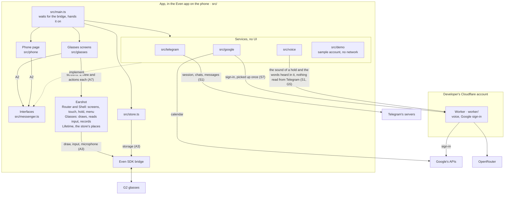
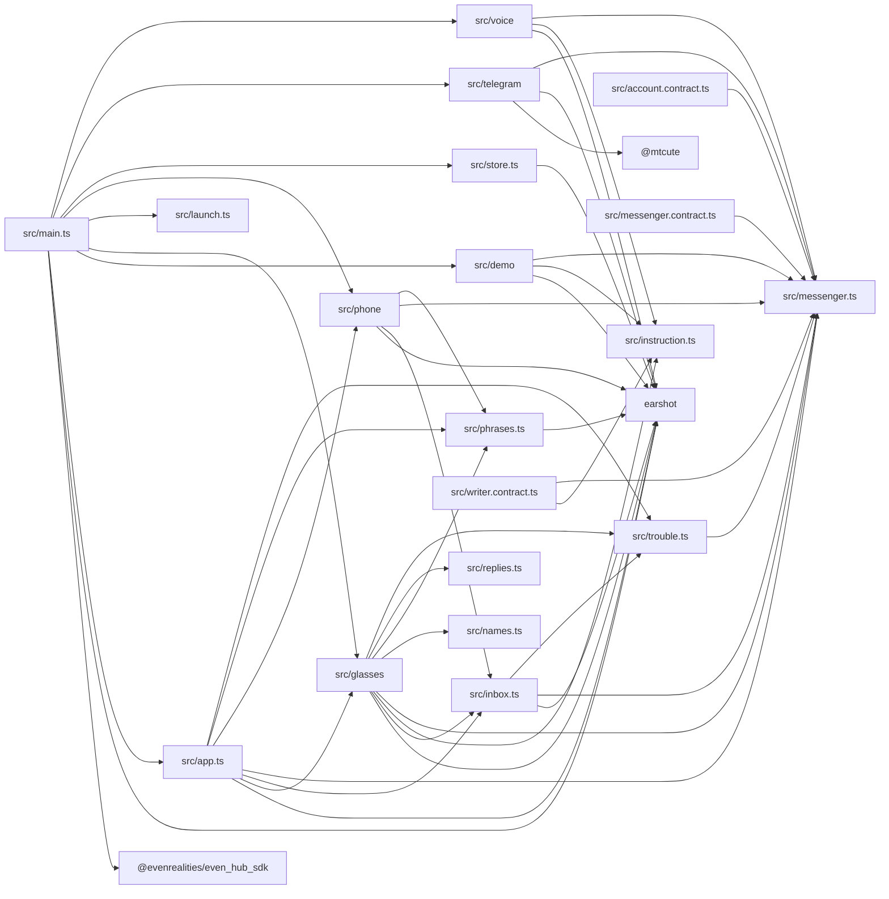

# Architecture

## Overview

Kept by hand. A change that adds or moves a module, a connection or a data flow updates this picture first, in its
design (skill `develop`). Arrows point from caller to callee. The picture is the rules of `CLAUDE.md`; a box with no
node in the module map below is not built yet.

Two things leave the phone for the Worker, and nothing else (S1). The OpenRouter key and Google's client secret
live only on the Worker (S3), which stores nothing but a Google sign-in on its way to the phone (S7).

Trouble is part of the interfaces, not of a screen: a call of `Messenger` fails with `TroubleError` when Telegram
cannot be reached (the service gives up on a call after fifteen seconds, and asks nothing once the connection has
been gone three) or asks the user to wait, and tells its listeners when Telegram is back. A message the user
confirmed is one attempt, however often it is tried: `send` takes the attempt, and the service gives every try of
it the same identity at Telegram, so a message whose answer was lost does not arrive twice: a later try is
answered with no message, which means sent, with nothing to take back. A sign-in that Telegram
ended from another device is told by `Account.onEnded` in the same step in which the service learns of it and
replaces its connection. Everything the account writes to the phone's store of the sign-in then runs in one line,
one write after the other, and a removal is done only when every copy has answered, so an old removal can never
land on a newer sign-in. The words for both are in
`src/trouble.ts` and `src/phone/signin.ts`; the sample account stages each (`src/demo`, A6).

What reaches the glasses is what the user picked on the phone: single chats, or a whole Telegram folder. A service
lists the account's folders (`Messenger.folders`) and says for each chat which of them it is in; `src/inbox.ts`
keeps a folder pick by the folder's id and name, and forgets it when the account no longer lists that folder.

Every screen is an Earshot screen: a view and a list of actions. Earshot's `Router` holds the stack of screens, its
`Shell` reads the touchpad, runs the action a tap, a swipe, the menu or the voice chose, and its `Glasses` alone
talks to the Even SDK bridge. Timers, listeners, sockets and requests belong to an Earshot `Lifetime` (A4), and code
that owns one awaits through it (A5).

## Module map

Generated from the imports ESLint sees, with the boundaries `eslint.config.js` enforces. Tests are left out. Arrows
point from importer to imported. `npm run check` fails when this is stale; `npm run architecture` regenerates it.

<!-- module-map:start -->

Enforced by `eslint.config.js`:

- **A1** src/telegram, src/google, src/voice, src/demo must not import src/glasses, src/phone.
- **A1** src/telegram, src/google, src/voice, src/demo must not import Router, Shell, Glasses, boxes, list, text, FRAME_TAG, Screen, View, RouterOptions, ShellOptions, ShellWords, GlassesOptions, GlassesBridge, Box, Frame, MenuItem, Picture, Brightness, Drawing, DrawOp, Input, HoldSource from earshot.
- **A2** src/glasses, src/phone must not import src/telegram, src/google, src/voice, src/demo.
- **A2** src (but not src/telegram) must not import @mtcute/.
- **A3** src (but not src/main.ts) must not import @evenrealities/even_hub_sdk.
<!-- module-map:end -->
